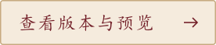
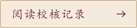
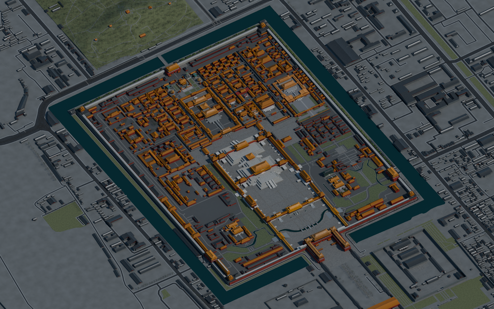
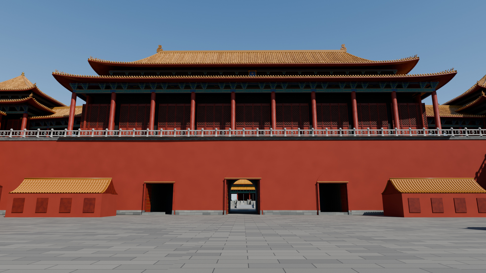
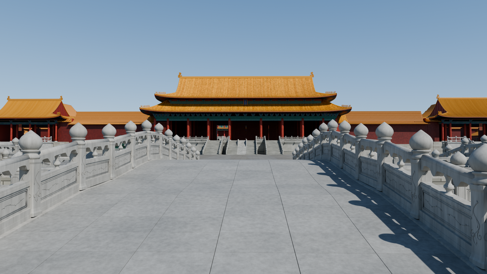
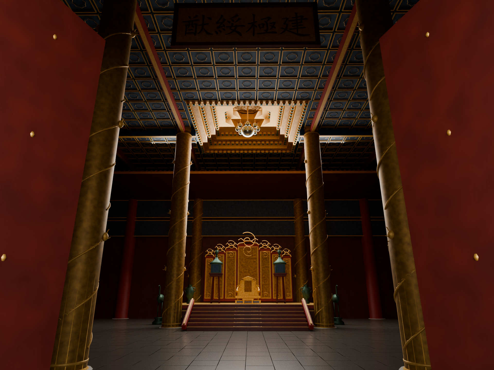
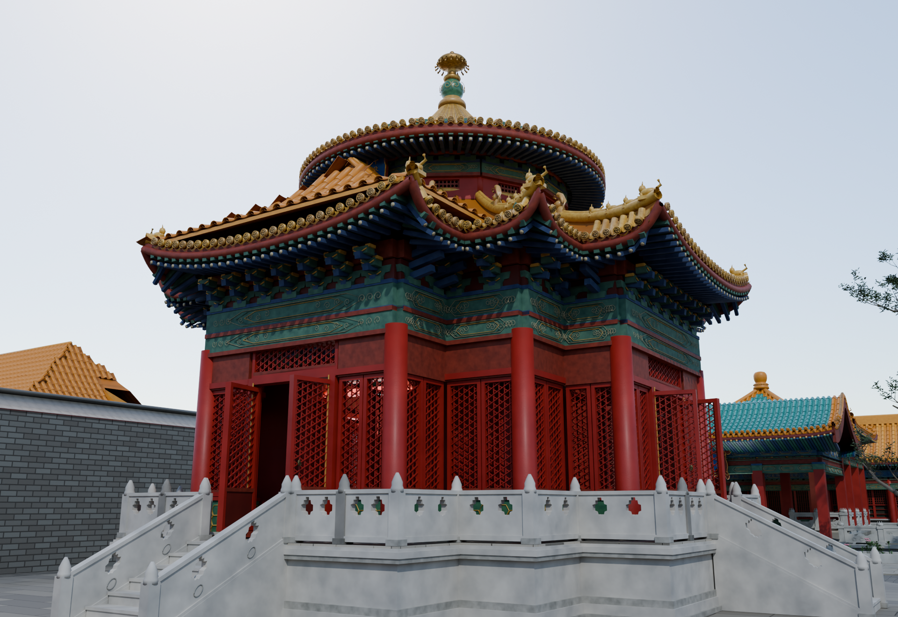

<p align="center">
  
</p>

<p align="center">
  以公开测绘资料、地图轮廓与实景影像为依据，持续营造一座可查看、可测量、可编辑的数字紫禁城。
</p>

<p align="center">
  <a href="#作品预览">作品预览</a> ·
  <a href="#入城指南">入城指南</a> ·
  <a href="#本版营造">本版营造</a> ·
  <a href="#工程与校核">工程与校核</a> ·
  <a href="#资料与精度">资料与精度</a>
</p>

<p align="center">
  <a href="https://github.com/daniei-chen/forbidden-city-reconstruction/releases/download/v0.2.0/Forbidden_City_Cross_Axis_Junctions_v4_Public.blend"></a>
  <a href="https://github.com/daniei-chen/forbidden-city-reconstruction/releases/latest"></a>
  <a href="verification/"></a>
</p>

<p align="center"><sub>当前公开版 v0.2.0 · Blender 4.5 LTS · 米制场景 · 原生可编辑工程</sub></p>

---

## 作品预览

从全城格局，到宫门前庭、殿内空间与御花园。以下均为 **v0.2.0 公开工程的实际渲染**。

### 城阙之间 · 全城格局

<a href="https://github.com/daniei-chen/forbidden-city-reconstruction/releases/tag/v0.2.0">
  
</a>

<p align="center"><sub>图一 · v0.2.0 公开工程实际渲染。主场景包含宫墙、护城河与宫院；各区域的复原细度仍有差异。</sub></p>

### 午门正面 · 由此入城

<a href="docs/assets/wumen-entrance-v0.2.0.png">
  
</a>

<p align="center"><sub>图二 · 在午门前庭正面望向宫门，视点接近人眼高度；从地面铺砖、门洞到重檐正楼，呈现入城时的空间关系。</sub></p>

### 内金水桥 · 望向太和门

<a href="docs/assets/taihe-approach-v0.2.0.png">
  
</a>

<p align="center"><sub>图三 · 沿御桥望向太和门，以两侧石栏和桥面形成进深，展示前庭、踏道与宫门的完整关系。</sub></p>

### 太和殿 · 殿内一望

<a href="docs/assets/taihe-interior-v0.2.0.png">
  
</a>

<p align="center"><sub>图四 · 从门内望向御座，呈现柱列、天花与藻井的层次。公开版使用程序化表面；陈设与雕刻仍含解释性重建。</sub></p>

### 御花园 · 千秋亭全景

<a href="docs/assets/qianqiu-pavilion-v0.2.0.png">
  
</a>

<p align="center"><sub>图五 · 从踏道旁望向千秋亭，以完整亭身、白石台基与周围宫院，展示御花园里的建筑尺度。</sub></p>

<p align="center"><sub>点击图二至图五可查看大图 · <a href="verification/readme_gallery_v0.2.0.json">查看出图记录</a></sub></p>

## 入城指南

| 当前公开版 | 打开环境 | 场景单位 | 本版廊下漫游 |
| :--- | :--- | :--- | :--- |
| **v0.2.0 · 朝会门区** | Blender 4.5 LTS | 1 Blender 单位 = 1 米 | 40 秒 · 约 49.64 米 |

1. **下载工程**：打开 [v0.2.0 发布页](https://github.com/daniei-chen/forbidden-city-reconstruction/releases/tag/v0.2.0)，在 **Assets** 中下载 `Forbidden_City_Cross_Axis_Junctions_v4_Public.blend`，约 **1.35 GB**。
2. **进入宫城**：用 Blender 4.5 打开 `.blend`，可查看、测量和编辑原生模型。文件较大，载入需要等待。
3. **切换视角**：在 Blender 顶部场景选择器中切换全城、局部建筑与漫游场景；选择“熙和门南庑 · 40秒慢行廊下漫游”，播放时间轴可查看这条已保存的相机路线。

> **下载提示**：GitHub 自动生成的 **Source code (zip / tar.gz)** 只包含仓库源码，不包含大体积模型。直接参观最新场景，请下载 Release 的 `.blend`。

## 本版营造

**v0.2.0 着重完善协和门、熙和门与太和门广场庑房的交接。** 本版保留完整宫城场景，并加入熙和门南庑约 49.64 米、40 秒的人眼檐廊漫游。

| 区域 | 已收录内容 |
| :--- | :--- |
| **外朝与朝会门区** | 太和殿内景，协和门、熙和门及相邻庑房交接，柱廊、格扇与屋面局部。 |
| **文华与武英殿组群** | 文华殿、文渊阁、武英殿组群与浴德堂的细化模型。 |
| **御花园** | 北部建筑及万春亭、千秋亭的亚字台基、四面踏道、重檐与可仰视藻井。 |
| **公开版表面与匾额** | 参考照片和航拍底图替换为程序化材质，可确认的匾额汉字转为网格；不包含原始照片、航拍文件或外链资源。 |

公开工程与本地含研究照片的母版有表面材质差异。匾额笔迹与满文尚未复原，各处细部的完成程度也不一致。

本版路线通过文件回读检查；地面支撑和身体、头部净空检查继承自同路径的 v3 校验。完整报告随 [Release 附件](https://github.com/daniei-chen/forbidden-city-reconstruction/releases/tag/v0.2.0) 提供。

## 工程与校核

想直接体验最新场景，请使用 Release 工程。以下入口用于理解工程组织、重建基础场景与追溯修订。

| 入口 | 用途 |
| :--- | :--- |
| [`source/`](source/) | 建模、细化、场景组织与公开打包脚本。 |
| [`verification/`](verification/) | 各版建筑尺寸依据、模型参数及文件重开检查记录。 |
| [`requirements.txt`](requirements.txt) | Blender Python 环境所需的依赖。 |
| [`source/prepare_public_release.py`](source/prepare_public_release.py) | 从已建成母版生成并校验无需外部素材的公开副本。 |
| [`source/render_readme_gallery.py`](source/render_readme_gallery.py) | 从公开工程中渲染本页的午门、太和门、殿内与御花园视角。 |

<details>
<summary><strong>重建基础场景</strong> · 环境准备与命令</summary>

使用 Blender 4.5。将 `requirements.txt` 中的依赖安装到 **Blender 自带的 Python** 环境中。Windows 便携版解释器位于 Blender 目录下的 `4.5/python/bin/python.exe`，可用它运行 `-m pip install -r requirements.txt`。如果该环境还没有 pip，先运行 `-m ensurepip`。

在仓库根目录执行：

```text
blender --background --factory-startup --python-exit-code 1 --python source/build_scene.py
```

命令假定 `blender` 在 PATH 上，也可使用可执行文件的完整路径。输出为 `The_Forbidden_City_1to1.blend`。

- 加上 `-- --preview`，可额外渲染一张太和殿预览。
- 加上 `-- --export`，可导出 GLB。
- 可通过 `PALACE_CJK_FONT` 指定本机中文字库；Windows 安装楷体时，脚本会自动使用系统字体。

仓库可在没有摄影贴图的情况下独立构建。基础构建结果使用简化材质，与包含城外扩展环境、细化瓦作及漫游动画的最新工程不同。源码中的 `1to1` 文件名表示采用实际米制单位。

</details>

<details>
<summary><strong>重建御花园基础场景</strong> · 浮碧亭与澄瑞亭</summary>

```text
blender --background --factory-startup --python-exit-code 1 --python source/build_scene.py -- --garden --preview
```

输出为 `The_Forbidden_City_Imperial_Garden_Base.blend` 与 `renders/fubi_garden_preview.png`。省略 `--preview` 可只构建模型。

浮碧亭、澄瑞亭各有贯通水池的单券桥、三开间柱网、可穿行抱厦与分层藻井；摛藻堂、位育斋位于两池北岸。各组使用同一次地图投影，桥、瓦、栏板、格扇与天花可在 Blender 中编辑。

</details>

<details>
<summary><strong>理解增量细化与检查</strong> · 版本和证据的对应关系</summary>

`source/refine_paired_halls_scene.py`、`refine_yude_tang_scene.py`、`refine_garden_scene.py`、`refine_north_garden_scene.py` 与 `refine_garden_twins_scene.py` 是增量脚本。

各脚本的 `BASE` 指向所需的上一版工程；`build` 以该工程为起点另存版本，`verify` 检查相应版本中的构件。基础构建命令不会直接生成最新 Release 的相同画面。

`verification/` 中的报告文件名对应各自检查的版本。历史报告中的路线与构件检查，不等于当前全城的实地测量，也不能替代逐像素现场比对。

</details>

## 资料与精度

本项目区分**文献记载、地图轮廓与照片推定**。场景采用米制，并不表示全部构件均有现场实测值；局部几何与路线检查通过，也不代表全城已经完成真实 1:1 或逐像素验收。

| 依据层次 | 在模型中的使用方式 |
| :--- | :--- |
| **测绘与文献** | 有明确记录的柱网、开间、形制及部分构件尺寸，按相应文献采用，并保留来源。 |
| **地图底稿** | 宫院、建筑、水系等轮廓使用同一地理底稿组织；地图精度不等于建筑测绘精度。 |
| **照片与推定** | 缺少测绘数据的标高、材质、雕刻、陈设及隐藏结构，仍包含解释性重建。 |

<details>
<summary><strong>展开资料索引</strong> · 地理底稿、馆方建筑资料与测绘研究</summary>

- **地理底稿**：`source/palace_osm_full.xml` 来自 OpenStreetMap。© [OpenStreetMap 贡献者](https://www.openstreetmap.org/copyright)，适用 [ODbL 1.0](https://opendatacommons.org/licenses/odbl/1-0/)。
- **太和殿**：柱网参考张学芹、刘畅《康熙三十四年建太和殿大木结构研究》表二、表三。[测绘论文](https://www.dpm.org.cn/Uploads/pdf/5077/T00035_00.pdf)；建筑总高、形制等参照[馆方建筑资料](https://www.dpm.org.cn/explore/building/236465.html)。
- **文渊阁**：柱网与楼层参考刘榕《从实测谈文渊阁结构与艺术特点》，《故宫博物院院刊》1993 年第 3 期。[馆方建筑资料](https://www.dpm.org.cn/explore/building/236513.html)。屋面高度、书橱位置及表面细节包含推定。
- **浮碧亭与澄瑞亭**：约 8 米通面阔、三开间、单券桥、绿瓦黄剪边与八方双龙藻井来自[浮碧亭](https://www.dpm.org.cn/explore/building/236498.html)和[澄瑞亭](https://www.dpm.org.cn/explore/building/236443.html)的馆方说明。池岸、亭址取地图轮廓；梁枋标高、雕刻、地坪与植物位置有照片推定。
- **摛藻堂与位育斋**：开间、硬山屋顶取[摛藻堂](https://www.dpm.org.cn/explore/building/236432.html)与[位育斋](https://www.dpm.org.cn/explore/building/236445.html)的馆方形制；轮廓取地图，格扇、梁枋与材质是重建件。
- **浴德堂**：平剖面参考[故宫古建部提供的测绘图](https://www.dpm.org.cn/Uploads/File/2021/11/08/u6188edf18abbd.pdf)；砖石、锅炉参考[现场记录](https://www.dpm.org.cn/Uploads/File/2019/07/17/u5d2e998b92f38.pdf)。
- **钦安殿**：柱脚、柱头与檐檩尺寸参考[大木测绘研究](https://www.dpm.org.cn/Uploads/File/2018/06/04/u5b1521c1583e4.pdf)。
- **万春亭与千秋亭**：平面及屋面关系参考[馆方建筑资料](https://www.dpm.org.cn/explore/building/236521.html)与[《明堂式道教建筑初探》图 14](https://img.dpm.org.cn/Uploads/File/2020/04/08/u5e8d77d699010.pdf)。原构件的精确标高、瓦件尺度与雕刻深度仍待进一步测绘。

</details>

第三方原始影像、航拍及论文扫描件保留在本地研究资料库。当前仍在逐栋核对，全城尚无逐物测量和逐像素比对记录。

---

<p align="center"><sub>循资料而营造，见细部而知不足。<br />紫禁城三维复原 · 持续修订中</sub></p>
